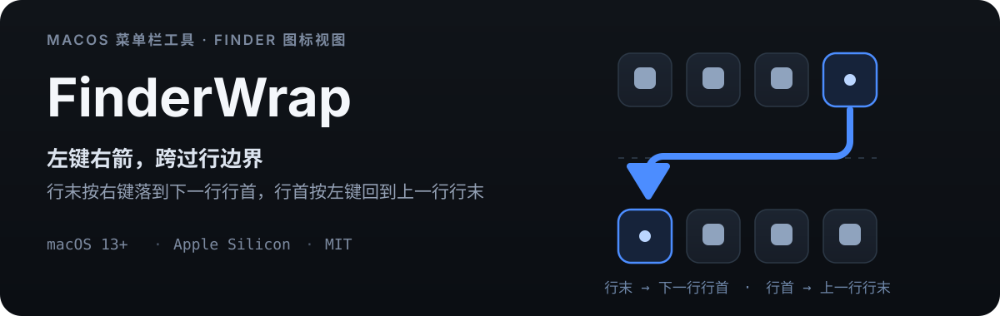

<p align="center">
  
</p>

Finder 图标视图里，左右键走到行末就停住了：想继续看下一行第一个图标，得先按一下方向键、再按一下。FinderWrap 是常驻菜单栏的小工具，把这两步合并成一步——**行末右键直接落到下一行行首，行首左键回到上一行行末**，整个图标区首尾也会循环。

## 它解决什么

- 图标视图的行边界不再是死路：跨行、首尾循环、分组与裁切行都按可见网格计算。
- 按住 Shift 时，左右键可以把多选范围继续扩到相邻行，不必重按。
- 画廊视图到两端循环；列表视图可选左右键切上一项/下一项，并保持端点不被误触发。
- 桌面、Quick Look、搜索/智能/iCloud 文件夹都在覆盖范围内。

## 覆盖范围

| 场景 | 行为 |
|---|---|
| 普通 / 搜索 / 智能 / iCloud 文件夹图标视图 | 跨行换行，文档首尾循环；单/多选均可，Shift 扩选跨行 |
| 按种类分组的图标视图 | 行按 Y 坐标聚类，跨组继续换行 |
| 行被窗口边缘裁切 | 只要边缘行可读到几何就参与换行 |
| 桌面图标 | 支持（桌面表面不是 AXGrid，按焦点 AXGroup 识别，逐项写选择） |
| Quick Look | 支持（继续驱动底下的图标布局，不抢焦点） |
| 画廊视图 | 缩略图条两端循环（可关闭） |
| 列表视图 | 左右键切上一项/下一项（独立开关）；**端点不循环** |
| 分栏、重命名、搜索框等编辑态 | 保持 Finder 原生 |

## 它怎么做到

<p align="center">
  
</p>

- **布局只读**：网格只在后台采集，从不改动 Finder 的显示状态。
- **写选择必须回读**：写回后用读回结果确认；只能逐项读时走 `AXSelected` 兜底，仍不确定就保持原生，不重放按键。
- **两次权限**：辅助功能 + 输入监控；1.0.7 起不再需要“自动化 Finder”（Apple Events）。

## 安装

Homebrew（推荐）：

```sh
brew tap ygnstudio/ygn
brew install --cask ygnstudio/ygn/finderwrap
brew upgrade --cask ygnstudio/ygn/finderwrap   # 升级
brew uninstall --cask ygnstudio/ygn/finderwrap # 卸载
```

也可以从 [Releases](https://github.com/ygnstudio/FinderWrap/releases/latest) 下载 DMG/ZIP，并用同名 `.sha256` 校验：

```sh
shasum -a 256 -c FinderWrap-1.0.14-b17-fixed-arm64.sha256
```

- 当前版本 **1.0.14（build 17）**，仅 Apple Silicon（arm64），最低 macOS 13；Intel 用户请保留 1.0.3。
- 使用固定自签证书、未做 Apple 公证：首次打开被拦截时，核对来源后到「系统设置 → 隐私与安全性」允许打开；Homebrew 保留系统安全检查。
- 首次启动授予辅助功能、输入监控，再开启「左右键自动换行」。应用只驻留菜单栏，无 Dock 图标与主窗口。
- 面板「界面」区可以隐藏菜单栏图标：应用继续在后台运行，重新打开 FinderWrap 时面板以小窗口出现。

## 兼容性与限制

| macOS | 状态 |
|---|---|
| 26.x | 本机实测通过（26.6.2 / Finder 26.4） |
| 15.x | 历史反馈过“无反应”（旧核心卡在窗口/section 校验）。1.0.10 已移除这些硬校验，增加结构回退与逐项兜底，**尚未实机复验** |
| 27.x | 未实机；使用 SDK 27 构建，结构回退与诊断同样适用，仍需实机确认 |

- 列表首尾不循环：向不可见行写选择会清空选择，端点按键因此被吞掉而非交给 Finder。
- Shift 扩选只覆盖 Finder 已加载的行；到未加载的滚动边界会保持当前选区并停止。
- 分栏、重命名、搜索框等编辑态保持原生；Quick Look 需从图标视图打开。
- AX 与 Apple Events 没有跨进程原子事务：不要同时用另一工具通过自动化更改 Finder 选择。
- 屏外目标、无法确认的折叠组会保持原生；预览版不做“所有布局必然支持”的承诺。

出现“无反应”时：点菜单栏图标 →「复制诊断信息」回传。诊断包含 macOS/Finder 版本、权限、焦点与窗口角色、网格标识、行/列数量与最近决策，**不含文件名、路径或按键内容**。详见 [兼容性文档](docs/compatibility.md)。

## 开发与测试

需要 Xcode 命令行工具，不引入第三方运行时依赖。

```sh
bash scripts/test.sh          # Swift XCTest + Python 签名/系统测试
bash scripts/build.sh Release # arm64 Release，输出 build/Products/Release
bash scripts/package.sh --fixed  # 固定证书已配置时生成 DMG/ZIP
```

- Swift 测试覆盖纯逻辑：行聚类、跨行换行、不齐末行、单行循环、文档首尾循环、多选锚点、重复 URL、非法几何；测试不访问 Finder、不发真实按键、不改权限。
- Python 测试覆盖签名策略、最低系统、固定证书规则；CI 另做 shell 语法检查与未签名归档。
- 构建与发布约束见 [验收](docs/testing.md) 与 [签名](docs/signing.md)。

<details>
<summary>仓库结构</summary>

```
FinderWrap/
├── Rebuild/                          # 生产实现：Swift Package 核心 + 菜单栏宿主
│   ├── Sources/FinderBridge/
│   │   ├── AX.swift                  #   有界 Accessibility 读取与写入助手
│   │   ├── GridModel.swift           #   网格模型 + 纯函数换行判决（可单测）
│   │   ├── GridReader.swift          #   后台布局抓取、表面识别、诊断
│   │   ├── LogoMark.swift            #   矢量标记（菜单栏与面板标题共用）
│   │   └── FinderWrapMonitor.swift   #   事件 tap、按键判决、写回校验、列表/画廊接管
│   ├── Host/                         #   AppKit 菜单栏宿主 + SwiftUI 面板
│   ├── Tests/FinderBridgeTests/      #   XCTest
│   └── Package.swift
├── Resources/Assets.xcassets/        # 应用图标
├── scripts/                          # 构建 / 测试 / 打包 / 签名 / 诊断
├── Tests/                            # Python 签名与系统测试
├── docs/                             # 架构 / 兼容性 / 验收 / 签名
├── config/signing.json               # 固定证书指纹与 designated requirement
└── .github/workflows/ci.yml          # CI：测试 → arm64 Release → 固定签名打包
```
</details>

## 许可与签名

[MIT](LICENSE)。应用使用固定自签证书、未公证、无遥测、不联网；权限由用户自行授予。签名沿用仓库固定证书（`config/signing.json` 固定指纹与 designated requirement），升级后签名身份不变，系统权限可继续沿用；macOS 升级或系统重置后仍可能要求重新授权。详见 [签名约束](docs/signing.md)。

<details>
<summary>发布流程</summary>

1. `main` 推送触发 [CI](.github/workflows/ci.yml)：单元测试 → arm64 Release → 架构与最低系统检查 → 未签名归档 + 固定签名安装包（`FinderWrap-fixed-signature-<sha>`）。
2. 下载固定签名附件，校验 SHA-256 与 `signing-policy.py verify`，生成 `vX.Y.Z` Release（DMG / ZIP / sha256 / signing.json 四个附件）。
3. Homebrew cask 更新 `version`、`sha256` 与 `depends_on arch/macos`；cask 位于 [ygnstudio/homebrew-ygn](https://github.com/ygnstudio/homebrew-ygn) 的 `Casks/finderwrap.rb`。
4. macOS 15 / 27 的实机验收仍是独立事项。

</details>

关注作者：[小红书主页](https://www.xiaohongshu.com/user/profile/66a7e7ae000000001d023641)
