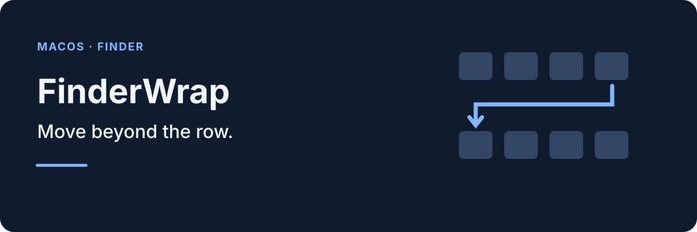
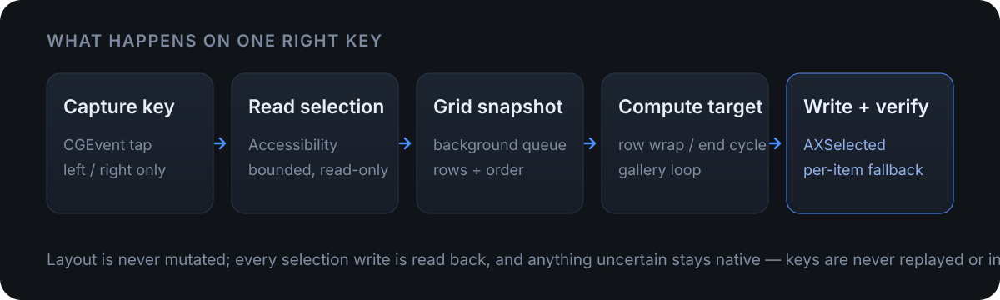

**English | [简体中文](README.zh-CN.md)**

<p align="center">
  
</p>

Finder's arrow keys stop at the end of a row in icon view. FinderWrap is a menu-bar utility that turns that dead end into one keystroke: **Right on the last icon moves to the first icon of the next row; Left on the first icon returns to the last icon of the previous row.** The whole grid also cycles at its ends.

## Features

- **Wrap between rows**: move across row boundaries and cycle from the last icon back to the first, instead of stopping at the edge.
- **Extend a selection**: hold Shift and press Left or Right to carry a multi-selection into the adjacent row.
- **Cover the common views**: ordinary, search, smart and iCloud folders, grouped rows, partially clipped rows and desktop icons.
- **Use Quick Look**: keep navigating the icon grid underneath while the preview window is open.
- **Cycle gallery thumbnails**: loop the thumbnail strip at either end, with an independent switch.
- **Navigate list view (optional)**: make Left and Right move to the previous or next item without triggering folder expansion at the ends.
- **Stay in the menu bar**: no Dock icon or main window; the icon can be hidden while the app keeps running.
- **Keep Finder's layout untouched**: the grid is only read, and every selection write is verified before the app moves on.

## Coverage

| Situation | Behavior |
|---|---|
| Icon view in ordinary, search, smart and iCloud folders | Wrap across rows and cycle at the document ends; single and multiple selection; Shift extends across rows |
| Icon view grouped by kind | Rows are clustered by Y position and wrapping continues across groups |
| Rows clipped by the window edge | Participates as long as the edge row exposes readable geometry |
| Desktop icons | Supported; the desktop surface is identified through the focused AXGroup and selection is written item by item |
| Quick Look | Supported; navigation continues on the icon layout underneath without stealing focus |
| Gallery view | The thumbnail strip cycles at both ends; can be disabled |
| List view | Left/Right move to the previous/next item (separate switch); **endpoints do not cycle** |
| Column view, renaming, search fields and other editing states | Finder's native behavior is preserved |

## How it works

<p align="center">
  
</p>

- **Read-only layout**: the grid is collected in the background and never changes what Finder displays.
- **Verify every write**: selection writes are read back immediately; when only per-item reads are available, `AXSelected` is the fallback. Anything uncertain stays native, and keys are never replayed.
- **Only two permissions**: Accessibility and Input Monitoring. Since 1.0.7, Automation for Finder (Apple Events) is no longer required.

## Install

Homebrew is recommended:

```sh
brew tap yangn-st/ygn
brew install --cask yangn-st/ygn/finderwrap
brew upgrade --cask yangn-st/ygn/finderwrap
brew uninstall --cask yangn-st/ygn/finderwrap
```

You can also download the DMG or ZIP from [Releases](https://github.com/YanGN-ST/FinderWrap/releases/latest) and verify it with the matching `.sha256` file:

```sh
shasum -a 256 -c FinderWrap-1.0.14-b17-fixed-arm64.sha256
```

- Current version: **1.0.14 (build 17)**, Apple Silicon only, macOS 13 or later. Intel users should stay on 1.0.3.
- The app uses a fixed self-signed certificate and is not notarized. If macOS blocks the first launch, verify the source and allow it in **System Settings → Privacy & Security**. Homebrew keeps its own security checks.
- On first launch, grant Accessibility and Input Monitoring, then enable left/right wrapping. The app lives only in the menu bar, with no Dock icon or main window.
- The **Interface** section of the panel can hide the menu-bar icon. The app keeps running in the background; opening FinderWrap again shows the panel as a small window.

## Get started

1. Open FinderWrap from the menu bar.
2. Grant Accessibility and Input Monitoring when prompted.
3. Enable left/right arrow wrapping in the panel.

The panel controls icon, gallery and list-view behavior. Gallery cycling and list-view navigation have their own switches. The menu-bar icon can be hidden while the app continues to run.

## Compatibility and limits

| macOS | Status |
|---|---|
| 26.x | Tested on this machine (26.6.2 with Finder 26.4) |
| 15.x | Earlier builds could appear unresponsive. 1.0.10 removed the hard window/section checks and added structural and per-item fallbacks, but 15.x has **not been re-verified on hardware** |
| 27.x | Not tested on hardware; built with the SDK 27 and covered by the same fallbacks and diagnostics |

- List-view endpoints do not cycle: writing a selection to an invisible row clears the selection, so endpoint keys are swallowed instead of being passed to Finder.
- Shift selection covers only rows Finder has already loaded. At an unloaded scroll boundary the current selection is kept and the move stops.
- Column view, renaming, search fields and other editing states keep Finder's native behavior; Quick Look must be opened from icon view.
- Accessibility and Apple Events have no cross-process atomic transaction. Do not change Finder's selection through another automation tool at the same time.
- Off-screen targets and collapsed groups that cannot be verified keep native behavior. The app does not promise that every possible layout is supported.

If FinderWrap appears unresponsive, choose **Copy diagnostics** from the menu-bar panel and send the result. The report includes the macOS and Finder versions, permissions, focus and window roles, grid identity, row/column counts and recent decisions. It **does not include file names, paths or typed keys**. See [compatibility](docs/compatibility.md) for details.

## Development and signing

<details>
<summary>Build, test and repository layout</summary>

Requires the Xcode command-line tools and no third-party runtime dependencies.

```sh
bash scripts/test.sh
bash scripts/build.sh Release
bash scripts/package.sh --fixed
```

- Swift tests cover pure logic: row clustering, cross-row wrapping, uneven last rows, single-row cycling, document-end cycling, multi-selection anchors, duplicate URLs and invalid geometry. They do not touch Finder, send real keys or change permissions.
- Python tests cover the signing policy, minimum system version and fixed-certificate rules; CI also checks shell syntax and builds an unsigned archive.
- Build and release constraints are in [testing](docs/testing.md) and [signing](docs/signing.md).

| Path | Contents |
|---|---|
| `Rebuild/Sources/FinderBridge/` | Accessibility helpers, grid model, background reader, monitor and vector mark |
| `Rebuild/Host/` | AppKit menu-bar host and SwiftUI panel |
| `Rebuild/Tests/` | XCTest target for the pure wrapping logic |
| `scripts/` | Build, test, package, sign and diagnostic scripts |
| `Tests/` | Python signing and system tests |
| `docs/` | Architecture, compatibility, testing and signing notes |
| `config/signing.json` | Fixed certificate fingerprint and designated requirement |

</details>

## License and signing

Released under the MIT license. The app uses a fixed self-signed certificate, is not notarized, has no telemetry and makes no network requests; permissions are granted by the user. The signing identity comes from the repository's fixed certificate (`config/signing.json`), so it stays the same across upgrades and existing permissions can continue to apply. A macOS upgrade or system reset may still require granting permissions again. See [signing](docs/signing.md) for details.

[MIT](LICENSE) · [Follow YanGN on Xiaohongshu](https://www.xiaohongshu.com/user/profile/66a7e7ae000000001d023641)
