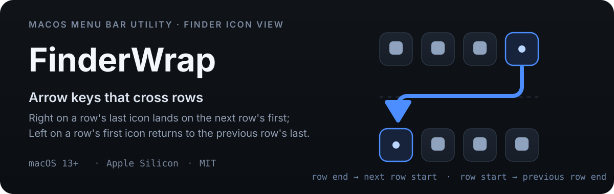
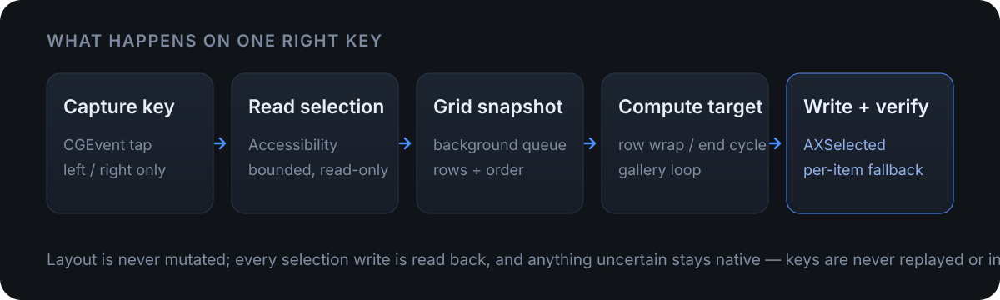

<p align="center">
  
</p>

In Finder's icon view, Left/Right stop at the end of a row: reaching the first icon of the next row takes two key presses. FinderWrap is a small menu-bar utility that turns that into one — **Right on a row's last icon lands on the next row's first, Left on a row's first icon returns to the previous row's last**, and the ends of the whole grid cycle as well.

## What it solves

- Row boundaries are no longer dead ends: wrapping, document-end cycling, grouped icons and clipped rows all follow the visible grid.
- Hold Shift and Left/Right keeps extending a multi-file selection across rows instead of restarting it.
- Gallery view cycles at both ends; list view can map Left/Right to previous/next item without mis-firing at endpoints.
- Desktop icons, Quick Look, and search / smart / iCloud folders are covered.

## Coverage

| Scenario | Behaviour |
|---|---|
| Ordinary / search / smart / iCloud icon views | Row wrap and document-end cycling; single/multiple selection, plus Shift range extension across rows |
| Grouped icon view | Rows clustered by Y coordinate; wrapping continues across groups |
| Rows clipped by the window edge | Participates as long as the edge row exposes geometry |
| Desktop icons | Supported (the desktop surface is not an AXGrid; identified via the focused AXGroup, selected per item) |
| Quick Look | Supported (keeps driving the grid underneath, does not steal focus) |
| Gallery view | Thumbnail strip cycles at both ends (can be disabled) |
| List view | Left/right previous/next item (separate switch); **endpoints do not cycle** |
| Column view, rename, search fields | Stay native |

## How it works

<p align="center">
  
</p>

- **Read-only layout**: the grid is collected on a background queue and never mutates Finder's display state.
- **Writes are verified**: every selection write is read back; when only per-item reads are possible it falls back to `AXSelected`, and anything still uncertain stays native — keys are never replayed or injected.
- **Two permissions**: Accessibility and Input Monitoring. Apple Events automation is no longer needed as of 1.0.7.

## Install

Homebrew (recommended):

```sh
brew tap ygnstudio/ygn
brew install --cask ygnstudio/ygn/finderwrap
brew upgrade --cask ygnstudio/ygn/finderwrap   # upgrade
brew uninstall --cask ygnstudio/ygn/finderwrap # uninstall
```

Or download the DMG/ZIP from [Releases](https://github.com/ygnstudio/FinderWrap/releases/latest) and verify it with the matching `.sha256`:

```sh
shasum -a 256 -c FinderWrap-1.0.14-b17-fixed-arm64.sha256
```

- Current version **1.0.14 (build 17)**, Apple Silicon (arm64) only, macOS 13+. Intel users stay on 1.0.3.
- Signed with a fixed self-signed certificate, not notarized: if the first launch is blocked, verify the source and allow it under System Settings → Privacy & Security. Homebrew keeps the system security check.
- Grant Accessibility and Input Monitoring on first launch, then turn on “Wrap left/right arrows”. The app lives in the menu bar only — no Dock icon, no main window. Settings are remembered, and the app restores itself on the next launch (staying off when permissions are missing).
- The Interface section can hide the menu-bar icon: the app keeps running in the background, and opening FinderWrap again shows the panel as a small window. Turn off Launch at login before uninstalling.

## Compatibility and limits

| macOS | Status |
|---|---|
| 26.x | Verified on real hardware (26.6.2 / Finder 26.4) |
| 15.x | Historic “no effect” reports (the old core was stuck on window/section checks). 1.0.10 removed those hard checks and added structural fallbacks; **not re-verified on hardware** |
| 27.x | Not verified on hardware; built with SDK 27, same fallbacks and diagnostics apply |

- List endpoints do not cycle: writing a selection on an invisible row clears it, so the end keys are consumed instead of being handed back to Finder.
- Shift range extension only covers rows Finder has loaded; at an unloaded scroll edge it keeps the current selection and stops.
- Column view, rename and search fields stay native; Quick Look must be opened from the icon view.
- AX and Apple Events have no cross-process atomic transaction: do not change Finder's selection with another automation tool at the same time.
- Off-screen targets and unconfirmable collapsed groups stay native; the preview build does not promise that every layout is supported.

If it does nothing: click the menu-bar icon → “Copy diagnostics”. The report contains macOS/Finder versions, permissions, focus and window roles, grid identity, row/column counts and recent decisions — **no file names, paths or key content**. See [compatibility](docs/compatibility.md).

## Development and tests

Xcode command-line tools are required; there are no third-party runtime dependencies.

```sh
bash scripts/test.sh          # Swift XCTest + Python signing/system tests
bash scripts/build.sh Release # arm64 Release into build/Products/Release
bash scripts/package.sh --fixed  # DMG/ZIP when the fixed certificate is configured
```

- Swift tests cover pure logic: row clustering, wrapping, ragged last rows, single-row cycling, document-end cycling, multi-selection anchors, duplicate URLs and invalid geometry; tests never touch Finder, send real keys or change permissions.
- Python tests cover the signing policy, minimum system and fixed-certificate rules; CI additionally runs shell syntax checks and an unsigned archive.
- See [acceptance](docs/testing.md) and [signing](docs/signing.md) for build and release constraints.

<details>
<summary>Repository layout</summary>

```
FinderWrap/
├── Rebuild/                          # Production code: Swift Package core + menu-bar host
│   ├── Sources/FinderBridge/
│   │   ├── AX.swift                  #   Bounded Accessibility read/write helpers
│   │   ├── GridModel.swift           #   Grid model + pure wrapping decisions (unit-tested)
│   │   ├── GridReader.swift          #   Background layout capture, surface detection, diagnostics
│   │   ├── LogoMark.swift            #   Vector mark shared by status item and panel header
│   │   └── FinderWrapMonitor.swift   #   Event tap, key decisions, verified writes, list/gallery takeover
│   ├── Host/                         #   AppKit menu-bar host + SwiftUI panel
│   ├── Tests/FinderBridgeTests/      #   XCTest
│   └── Package.swift
├── Resources/Assets.xcassets/        # App icon
├── scripts/                          # Build / test / package / signing / diagnostics
├── Tests/                            # Python signing and system tests
├── docs/                             # Architecture / compatibility / acceptance / signing
├── config/signing.json               # Pinned certificate fingerprint and designated requirement
└── .github/workflows/ci.yml          # CI: tests → arm64 Release → fixed-signature packaging
```
</details>

## License and signing

[MIT](LICENSE). Signed with a fixed self-signed certificate, not notarized, no telemetry, no network access; permissions are granted by the user. The fixed certificate and designated requirement in `config/signing.json` keep the signing identity stable across updates so system grants survive; a macOS upgrade or a system reset may still ask again. See [signing](docs/signing.md).

<details>
<summary>Release flow</summary>

1. A push to `main` triggers [CI](.github/workflows/ci.yml): unit tests → arm64 Release → architecture and minimum-system checks → unsigned archive + fixed-signature package (`FinderWrap-fixed-signature-<sha>`).
2. Download the fixed-signature artifact, verify SHA-256 and `signing-policy.py verify`, then publish a `vX.Y.Z` Release with four assets (DMG / ZIP / sha256 / signing.json).
3. Update the Homebrew cask `version`, `sha256` and `depends_on arch/macos`; the cask lives at `Casks/finderwrap.rb` in [ygnstudio/homebrew-ygn](https://github.com/ygnstudio/homebrew-ygn).
4. Real-hardware acceptance on macOS 15 / 27 remains a separate task.

</details>

Follow the author: [Xiaohongshu](https://www.xiaohongshu.com/user/profile/66a7e7ae000000001d023641)
